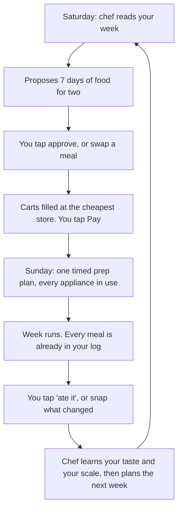
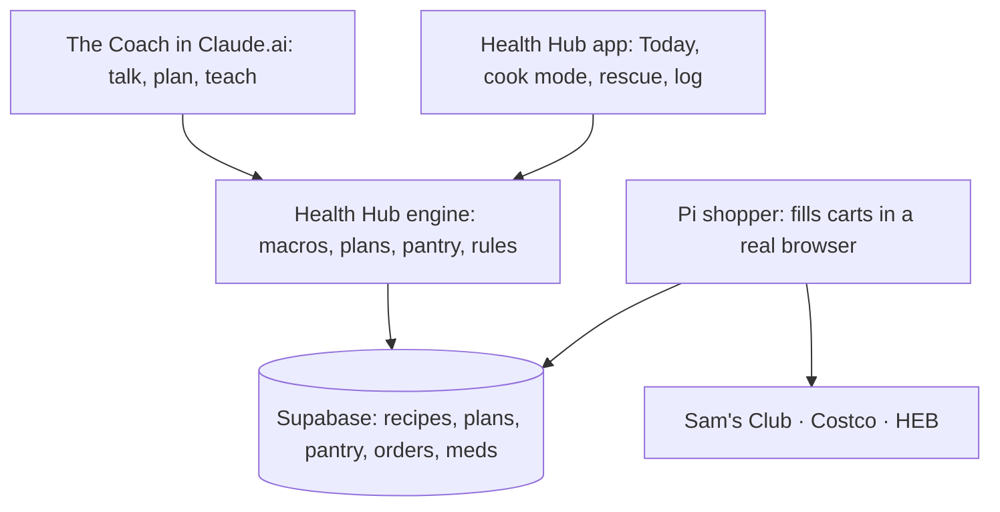

# The Kitchen: food on autopilot

==The goal isn't a recipe app. It's that you never have to decide what to eat, buy, or cook again, and the right food is always the easiest food in the house.== You cook, you learn, and the chef handles everything else.

Your diets haven't failed because of knowledge. They fail at a few moments: 6:45 PM with nothing planned, a weekend nobody logged, a day over target that turns into "screw it", a scale jump that feels like failure. The Kitchen is built to win those moments.

## The weekly loop

What the chef reads before it plans: your training days, the Wednesday fast, last night's Oura, your calendar, Austin weather (grill night or not), what's already in the pantry, what's on sale, and how last week went.

## Seven things that change your life

### 1. Zero-decision weeks

Saturday morning you get one message: next week's plan, its cost, and the cart. One tap approves it. Every dinner is one pot, two plates, with exact grams for you and for Danielle. Lunches are last night's leftovers, cooked big on purpose. Your day is already planned before it starts.

### 2. Your log fills itself

Planned meals go into Health Hub ahead of time. You only confirm, or snap a photo when reality changed. Logging stops being a chore you skip and becomes one tap. That fixes the gaps (no food entries Oct 9 to 11) without willpower.

### 3. A pantry that knows itself

The chef builds your pantry from your Sam's, Costco and HEB receipts, then subtracts what each recipe uses. No manual counting. Whey, Nurri, psyllium and supplements reorder before they run out. Chicken about to expire gets moved into tomorrow's plan.

### 4. Cooking school, one dinner at a time

Every recipe teaches one skill, and the skills build on each other:

1. The stainless steel pan: preheat it dry, the water-drop test, then oil. Food sticks, then lets go when it's ready. Don't move it.
2. Searing, resting meat, using a thermometer
3. Fond, the brown bits left in the pan, turned into a pan sauce in two minutes
4. Knife basics, rice, potatoes and roast vegetables done right
5. Seasoning by taste, the reason diet food can taste great
6. Fish, grilling, eggs every way
7. Graduation: open the fridge and cook without a recipe

Cook mode is hands-free on your phone: big steps, built-in timers, "why this works" in one line, and a "next" you can say instead of tap.

### 5. The rescue button

It's 6:45, you're tired, and the plan fell apart. One tap gives three ways out, all fitted to what's left of today's macros: a 15-minute meal from what's in the house, a frozen backup that's always stocked, or an exact custom order at a nearby restaurant with official numbers. Over target yesterday? The chef quietly reshapes today so the week still lands, and no day feels ruined.

### 6. The scale explained

When the scale jumps (184.3 this morning after 181.4 on Oct 8), the chef checks sodium, carbs and timing from your food and says why, in one line. Water weight stops looking like fat gain. That's the moment "screw it" usually starts.

### 7. Your gut, finally mapped

Your GI issues run in the family and nobody has ever tracked them against food. A one-tap gut check each evening, lined up with what you ate and how you slept, can show patterns in a few weeks. It's not a diagnosis. It gives your doctor real data instead of memory.

## Also in the box

- **Trend scout.** Each week, two new high-protein recipes from what's popular online, rebuilt for your kitchen, your products and your macros. Rate them after dinner. Winners join the rotation.
- **Meds and supplements.** One schedule, push reminders, reorder before you run out, and the noon psyllium kept 2 hours away from finasteride. The chef never changes a dose.
- **Cost per gram of protein.** Price compared across the three stores. A weekly grocery number you can see.
- **Danielle's side.** She has high cholesterol, so every shared dinner is heart-healthy by default: less saturated fat, more soluble fiber, fish twice a week or more. She gets "what's for dinner and my plate" without tracking anything.
- **Microwave nights get better, not banned.** Frozen backups stay, but upgraded: Instant Pot and rice cooker batches you can reheat in 3 minutes.
- **Calendar-aware.** Thanksgiving falls on Nov 26, three days before the cut ends. The chef plans it now: a protein-first plate, a banked-calorie week, and no spiral after.
- **After the cut.** On Nov 29 the chef moves you to maintenance on its own, so the end of the block doesn't become a rebound.
- **Voice.** "What's for dinner?" or "What can I eat right now?" through Siri or the Coach in Claude.ai.

## How it fits together

One brain, the engine, same as today. The Coach is the voice, the app is the hands, and the Pi does the shopping.

## The honest catches

!!! warning "Read these before we commit"
    - **No store lets apps order.** The Pi shopper drives a real browser while logged in as you. It works, but a site redesign can break it, and stores dislike bots. You always tap Pay, so a mistake costs a fixed cart, not money.
    - **Cronometer is read-only.** The Kitchen's meals live in Health Hub. Cronometer stays your source for anything you eat outside the plan, unless we decide Health Hub becomes the one food log.
    - **Medical lines stay drawn.** Reminders and patterns, yes. Doses and diagnoses, never.
    - **This is big.** It ships in slices, each useful on its own.

## Build order

| Slice | What you get | Why first |
|---|---|---|
| 1 | Profiles, recipe library, weekly plan, log pre-filled | Kills the most failures fastest |
| 2 | Shopping list, pantry, cart filling | Removes the store trip |
| 3 | Cook mode and cooking school | Makes it fun to keep doing |
| 4 | Rescue button, scale explainer, gut map | Wins the bad moments |

Reference notes from your old docs: [Chef profile](profile.md). What you have now: [Kitchen catalog](kitchen.md) (Nov 9). October snapshot: [Pantry and first list](pantry.md). This week's breakfast: [Egg White Grill, batch of 8](egg-white-grill.md).

## Where it stands

Status on 2026-10-14: still brainstorming, no code yet. The chef profile, the pantry and freezer list, the Sam's receipt, a draft week, and the first Sam's list are done. Next: Dylan sends fridge photos. Then we write the slice 1 spec: pantry, recipes, week plan, Coach tools, and tonight's dinner in the app, logged ahead of time.

Update on 2026-11-08: the Kitchen app is still not built. The chef is working by hand in chat. First batch made on Nov 8 from that day's Sam's receipt: 8 egg white sandwiches for breakfast, with an apple and a Nurri.

Update on 2026-11-09: spice run at Randalls. The [Kitchen catalog](kitchen.md) is now the one list of food, seasonings, appliances and pans. Next: Dylan answers the open questions on that page, then the chef becomes its own project, separate from Brockbot.

Decided on 2026-11-09 (springboard): the Chef is its own agent with its own files: pantry, recipes, cook log, trend finds. It is not the Coach. The Coach keeps Health Hub, and the two read each other's data: the Chef reads macros left, phase and scale trend, and the Coach reads what was cooked. The core is a nightly dinner ticket: one recommendation, two fallbacks (a quick cook and a batch meal from the freezer), plates in grams for both of you, a "move to the fridge tonight" line, and Perfect / Dry / Underdone feedback that changes one thing next time. Biggest risk: the inventory drifts. Fixes: choosing a dinner subtracts its ingredients, a Sunday fridge and freezer photo resets the count, and only proteins and key staples are counted exactly.

Handed off on 2026-11-09 to a new thread (`~/.claude/handoffs/2026-11-09-chef-agent.md`). New rules: when data is missing, the Chef asks and never guesses. Cooking at home is a must for both Dylan and Danielle, to save money, get healthier and lose weight.

Correction on 2026-11-09: the core is not a short dinner ticket. It's teaching Dylan to cook: full recipes written for him, covering when to start, every step with temps, times and grams, what done looks like, and why. The Egg White Grill page is the minimum level of detail.

Also on 2026-11-09: the Chef works in chat. Recipes arrive in the conversation, not as HTML pages. These docs are the Chef's memory, not something Dylan opens.

Update on 2026-11-09: the [slice 1 spec](slice-1-spec.md) is written and was reviewed by a second model. The review changed four things: a push cannot open a Claude chat, so the thaw push carries the whole action in its text; thaws can be planned up to 3 days ahead (the frozen 5.5 lb block needs about 48 hours); confirmed standing defaults replace daily questions; and the build starts with a test of whether Claude.ai keeps the Chef's and the Coach's connectors apart. Waiting on Dylan's yes to the plain-words plan.

Decided on 2026-11-09 (Dylan): the Chef talks on Discord, for now in the #coach channel, as a Hermes agent on the Pi like the Coach, Scout and Researcher. The slice 1 spec's Claude.ai connector plan is dropped and gets rewritten for Hermes.
