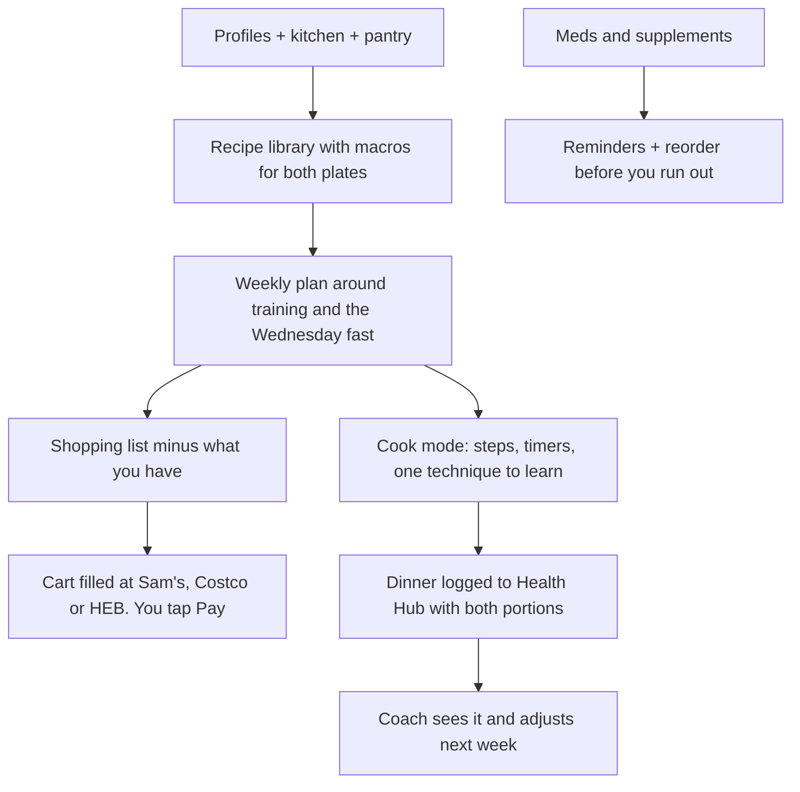

# Chef profile: reference notes

This is what your AI chef would start from. Most of it comes from old notes, so ==anything marked "confirm" is a guess until you say it's right==.

!!! warning "Old notes disagree with today"
    The March plan was a recomp block (eat at maintenance, WHOOP, Monday fast). Today you're on a cut (Oura, Wednesday fast, 175 goal). Where they disagree, I used your live app settings and the July Coach notes.

## Who eats

| | You | Danielle |
|---|---|---|
| Goal | Cut to 175 by Nov 29 | Fat loss, lower cholesterol |
| Calories | 2,000 most days · 900 Wed | 1,350 flat |
| Protein | 200 g · 150 g+ Wed | 105 g |
| Tracks? | Cronometer | No. Her plate size does it |

The real lever is shared dinners with two plate sizes. You cook one meal, and the portions differ.

## Your day of food (July notes, confirm)

1. 6:30 AM shake: 2 scoops Gold Standard vanilla, banana, chia. About 400 cal, 52 g protein.
2. Noon lunch: protein, vegetables, fruit. No starch.
3. 3 PM Nurri shake (150 cal, 30 g).
4. 6:30 PM dinner: protein, one rice cup or 6 oz potato, vegetables. Done by 7.
5. Chobani buffer if there's room. Skip it on salmon nights.

Wednesday is the fast: water, electrolytes and coffee by day, psyllium at noon, Nurri at 6, one meal at 6:30.

## Rules the chef must follow

- Protein first in every meal, then carbs and fat around it.
- Fat 70 to 85 g a day is a floor, not a ceiling. Lean meats mean fat has to be placed on purpose.
- Starch at dinner only on weekdays. Fruit during the day.
- Fish three times a week.
- GI issues run in your family. Change fiber slowly and flag every new supplement.
- Never guess restaurant macros quietly. Official data first, or say there isn't any.
- No reduced-calorie weekends. They failed twice. Weekends stay at 2,000 and get logged.

## What you both like

Danielle: likes fish and loves salmon. Loves rice and mashed potatoes. No very spicy food (mild heat is fine).

You: no dislikes or gut triggers you know of. You like potatoes more than rice. Your favorites, going by what you buy and cook: salmon, shrimp, chicken, turkey taco bowls, steak on the grill, rice, potatoes.

Starch rule: potatoes are the default, since you both like them. Rice nights are fine for her. Some nights the plates split: the rice cooker runs hands-off for her while potatoes go in the air fryer for you.

## Products you already trust

Gold Standard vanilla whey · Nurri (Costco) · Just Bare nuggets · Fresh Additions chicken bites · Fage Greek yogurt · Chobani · Quest chips · Thai Kitchen brown rice noodles · Kirkland psyllium.

## Daily meds and supplements (as of Oct 13, 2026)

| Time | What |
|---|---|
| Morning | Finasteride, oral minoxidil, Zyrtec |
| Night | Magnesium glycinate, L-theanine, apigenin |

Stopped since July: BPC-157, creatine, electrolytes, psyllium, CBD. Creatine restart recommended on Oct 13 (3 to 5 g a day, with food), not yet decided.

The chef reminds and reorders. It never changes a dose. Your doctor owns that.

## Current dinner rotation (in the app now)

| Day | Dinner |
|---|---|
| Mon | Sheet-pan salmon |
| Tue | Salsa chicken bowls (prepped) |
| Wed | Your fast. Danielle: rotisserie chicken |
| Thu | Air fryer shrimp or cod |
| Fri | Turkey taco bowls |
| Sat | Grill night, cooked together |
| Sun | Prep day, plus an easy dinner |

## Kitchen

Stainless steel pan (the one you want to master) · nonstick pan · air fryer · oven · rice cooker · Instant Pot · microwave (used a lot lately) · freezer full of frozen goods.

Bakeware (photo, Nov 8): Samsung gas range with Bake and Convection Bake · NutriChef nesting set (deep rectangular, shallow rectangular, square, round) · light sheet pan with rust, use foil · dark brown cookie sheet.

Also seen Nov 8: dual-basket air fryer with Smart Finish · KitchenTour digital food scale.

Still unknown: knives, cutting board, meat thermometer, spices. A short photo walk-through fills this in.

## Danielle's heart

Danielle has high cholesterol. That makes every shared dinner heart-healthy by default:

- Less saturated fat: lean meats, fish, olive oil instead of butter, 0% Greek yogurt.
- More soluble fiber: oats, beans, lentils, barley, apples, psyllium.
- Fish at least twice a week, salmon first.
- Red meat becomes once a week, lean cuts only.

No doctor's target and no cholesterol medicine as of Oct 13, 2026. If a doctor sets either, that wins over these defaults. It fits your plan too: your fat floor is met with olive oil, fish and avocado, not butter and cheese.

## Stores

Sam's Club (free delivery), Costco, HEB. The chef fills the cart in a browser. You tap Pay. A saved card or Stripe comes later, if ever.

## What the chef could do

Ideas beyond your list:

- **Teach as you cook.** Each recipe carries one skill: searing, knife work, cooking rice without a cup, resting meat. They build over weeks.
- **Recovery-aware nights.** Bad Oura score or a late day means a zero-cook dinner gets swapped in.
- **Leftovers become lunch.** Dinner is cooked a little big on purpose so noon is already done.
- **Cost per gram of protein.** Compare the three stores and buy where it's cheapest.
- **"What can I make right now?"** Snap the fridge, get a meal that fits what's left of today's macros.
- **Run-out alerts.** Whey, Nurri, psyllium and supplements reorder before they're gone.
- **Fill the logging gaps.** Your food log has holes (no entries Oct 9 to 11). Planned meals can pre-fill, so you only confirm.

## Open questions

- Restart creatine?
