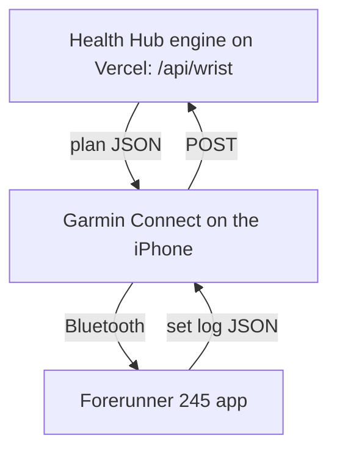

# Garmin gym app

A Connect IQ app on Dylan's Forerunner 245 shows Health Hub's next set, runs the rest timer, buzzes when rest ends and logs each set with one press. The plan and the log travel through Garmin Connect on the iPhone over Bluetooth. Health Hub's engine does all the math at both ends.

## The path



!!! note "Why not our own Bluetooth bridge"
    The first design had our own iPhone app talk to the watch directly. The red-team found two blockers. The fr245 cannot keep a Bluetooth pairing between app launches (`pairDevice` does not persist; bonding needs API 4.2.5). An iPhone app in the background also hides its service from non-Apple devices. So the bridge app would have to be open on screen at every sync. Garmin Connect already keeps the link in the background, and it needs no iPhone app or 7-day reinstall.

## Parts

- **Engine** (`lib/engine/wrist.mjs`): `wristPlan` turns `buildSession` into small JSON, so weights, reps, rest and the goal line are the app's own. `applyWristLog` matches sets by lift id, stamps each set with the log id (`lid`), and runs `applyWorkout`. A resent log is recognised from the saved workout, so it applies once.
- **Route** (`lib/wrist-route.mjs`): served as `/api/wrist`, a rewrite onto `api/sync-steps.js`, because the Hobby plan allows 12 functions. Bearer token = `wristToken(SYNC_TOKEN)`, an HMAC. The watch carries only that token, so it can't reach any other route. Progression is written first and the workout last, so a failure part-way means the watch resends and the whole log applies again.
- **App** (`src/app.jsx`): the foreground pull now includes `wk` and `prog`, so a watch workout shows up without a relaunch.
- **Watch** (`garmin/`): offline-first. The plan is cached in Storage. The session is saved after every press, so a killed app resumes on the same set. Finished logs wait in an outbox until the server says ok. Records a native strength activity (one lap per set), which keeps the heart-rate sensor on.

## Messages

Plan (GET `/api/wrist`, optional `?date=&day=`):

```json
{"v":1,"id":"k3j9x","date":"2026-11-09","day":"monday","name":"Upper A - Strength",
 "ex":[{"i":"machine-chest-press","n":"Machine Chest","w":135,"u":"","st":5,"r":[8,8,8],"g":"Same weight. One more rep..."}],
 "seq":[[0,0,150],[0,1,150],[0,2,0]]}
```

`seq` is the set order (supersets already interleaved) with the rest after each set. Weight 0 = body weight. `u`: "" = lb, `ea` = per hand, `side`, `asst`, `BW`.

Log (POST `/api/wrist`):

```json
{"v":1,"id":"6730f1a2b4c5d6","plan":"k3j9x","date":"2026-11-09","day":"monday","t0":1762693200,"t1":1762696800,
 "d":[[0,"machine-chest-press",0,135,8,1762693500,112,141,0]],"k":[[3,2]]}
```

`d` rows: lift index, lift id, set index, weight, reps, time (s), average and peak heart rate during the set, step index (watch only). `k`: skipped sets.

## Buttons (fr245)

| Screen | START | UP / DOWN | Hold UP | BACK |
| --- | --- | --- | --- | --- |
| Home | Start or resume | | Sync now | Exit |
| Set | Log the set (from either field) | Reps ±1, or weight ± one step after BACK | Undo, skip, goal, finish | Weight focus, then Finish? (body-weight lifts: Finish? at once) |
| Rest | Go now | | | Undo last set |
| Done | Close | | | Close |

### Changing the weight on the watch

The set screen shows weight and reps; the one in ember is what UP/DOWN change. Reps have focus at the start of every set, so START logs the planned set with one press, as before.

1. BACK: the weight turns ember and the hint says the step (`weight +/-2.5`). UP/DOWN move it by the lift's own increment from the plan (`st`, 2.5 or 5). Dumbbells read "ea".
2. START logs the set with the weight and reps on screen.
3. The edited weight stays for the next set of that lift. Focus goes back to reps after every log or undo.
4. BACK again (in weight focus) opens "Finish workout?". "No" returns with reps in focus. A body-weight lift (planned weight 0) has no weight step: BACK goes straight to the prompt.

A loaded lift cannot go below one step; added weight (BW+) can go back to 0.

## Watch and phone on the same session

If Dylan logs a session on the watch and on the phone, the copies fold into one entry per lift (`foldLiftCopies`, `foldDayLog` in `lib/engine/progression.mjs`). The phone's weight and reps win, the watch adds set times, heart rate and its log id (`lid`, so a resent watch log still applies once). Sets pair by position; the phone's set count wins. A phone swap wins over the planned lift the watch logged (they match by slot). The day keeps its program name instead of "multi". It works in any order: the phone finishing after the watch (`applyWorkout`), the watch posting after the phone (`applyWristLog` → `applyWorkout`), and the phone save path (`keepWristSets`). Progression reads the folded entry. 2026-11-12 predates this: `scripts/fix-wrist-double.mjs` folds that day (dry run by default).

## Build and install

1. Device files: `connect-iq-sdk-manager login` (Garmin account), then `device download --manifest=garmin/manifest.xml`.
2. `garmin/scripts/build.sh` writes the gitignored `secrets/Secrets.mc` (URL + wrist token from `.env.local`), makes a developer key once, and builds `garmin/bin/HealthHubGym.prg`.
3. On the Mac: quit Garmin Express, plug in the watch, and copy the `.prg` file to `GARMIN/APPS` with OpenMTP.
