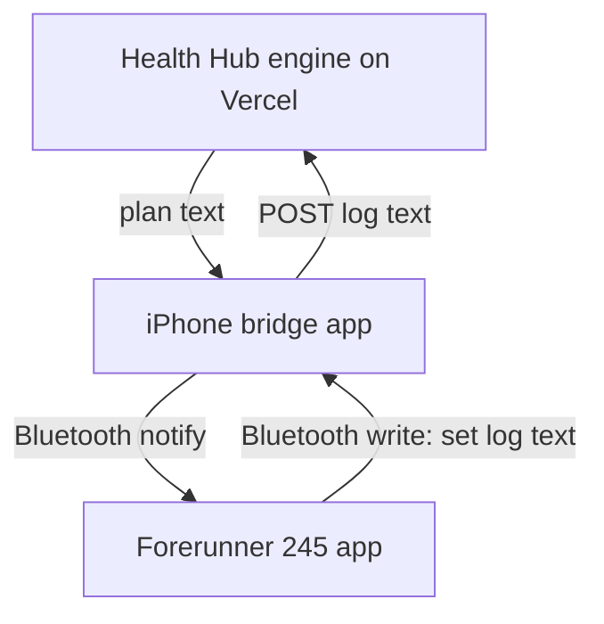

# Garmin gym app: design

A Connect IQ watch app on Dylan's Forerunner 245 shows Health Hub's next set, runs the rest timer, buzzes when rest ends and logs each set with one press. It talks to Health Hub through a small iPhone app over Bluetooth, not through Garmin Connect.

## The path



- **Server:** `/api/wrist`, a rewrite onto `api/sync-steps.js` (Hobby plan allows 12 functions; we are at 12). Gate: `SYNC_TOKEN` (the phone bridge already holds it for the band). GET returns today's plan as text; POST takes the watch's log text, turns it into a workout through `applyWorkout`, writes `workouts` + `progression` rows, and files a `wrist:<logId>` receipt row in `program` (VIRTUAL) so a resent log is ignored.
- **Engine:** `lib/engine/wrist.mjs`. `wristPlan` (from `buildSession`, so weights, reps and rest are the app's own) and `applyWristLog` (log text → workout → `applyWorkout`). All parsing and rules live here and are tested.
- **Phone:** a dumb pipe. BLE peripheral with one service and two characteristics: RX (watch writes) and TX (phone notifies). Messages are UTF-8 text cut into 20-byte frames: byte 0 = frame index (bit 7 set on the last frame), bytes 1..19 = text.
- **Watch:** BLE central (`Toybox.BluetoothLowEnergy`, supported on the fr245). Scans for the bridge's service each sync (iPhone rotates its address, so stored pairing is not trusted). Works offline from a cached plan. Sets are stored after every press; finished logs wait in an outbox until the phone acknowledges them.

## Message formats (text, one record per line, fields split by `|`)

Plan (server → watch):

```
P|1|<planId>|<date>|<day>|<session name>
E|<exIdx>|<exercise id>|<name ≤ 18 chars>|<weight>|<unit>|<step>|<reps csv>
S|<exIdx>|<setIdx>|<rest seconds after this set>
```

`S` lines are the order to do the sets in (supersets already interleaved by the engine's `sessionCursor` rule). Weight 0 = body weight.

Log (watch → server):

```
L|1|<logId>|<planId>|<date>|<day>|<start epoch s>|<end epoch s>
D|<exIdx>|<exercise id>|<setIdx>|<weight>|<reps>|<epoch s>|<avg hr>|<max hr>
K|<exIdx>|<setIdx>
```

`K` = skipped set. Acks (phone → watch): `A|<logId>|ok` or `A|<logId>|err|<reason>`.

## Watch screens (fr245: 240×240, five buttons, no touch)

- **Home:** session name, lift count, sync state, unsynced count. START begins.
- **Set:** lift, set n of m, big `185 × 8`, heart rate. UP/DOWN change reps. START logs the set "as done". Hold UP (menu): weight ±step, skip set, skip lift, finish.
- **Rest:** big countdown, next set preview. Buzz + tone at zero. START skips rest.
- **Done:** sets, volume, "3 unsynced" until the phone acks.

Recorded as a native strength activity so the heart-rate sensor stays on and the app stays open.
