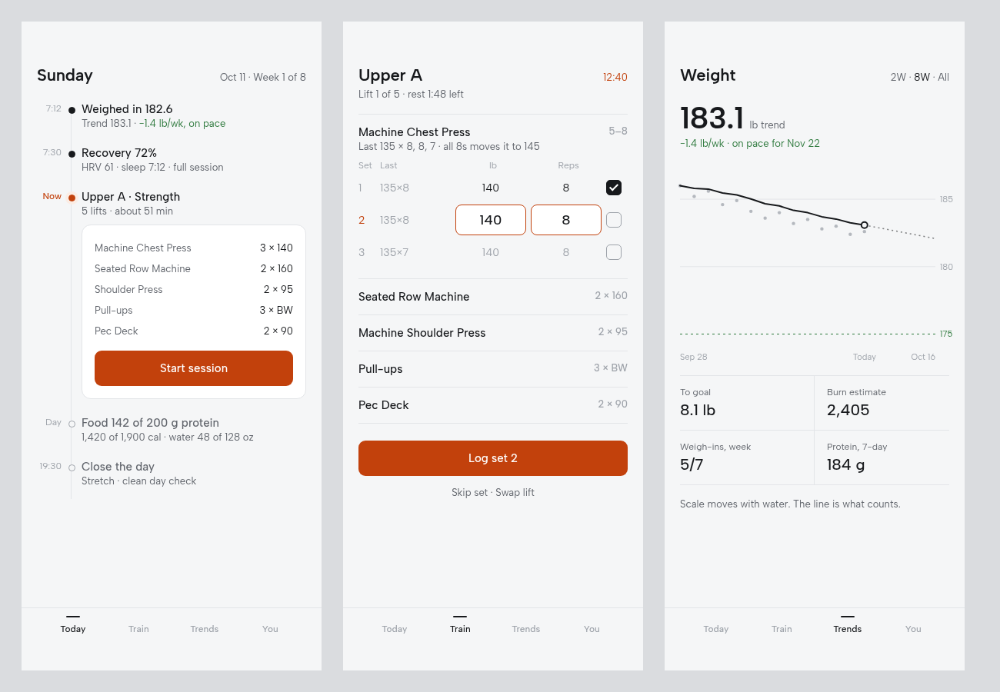
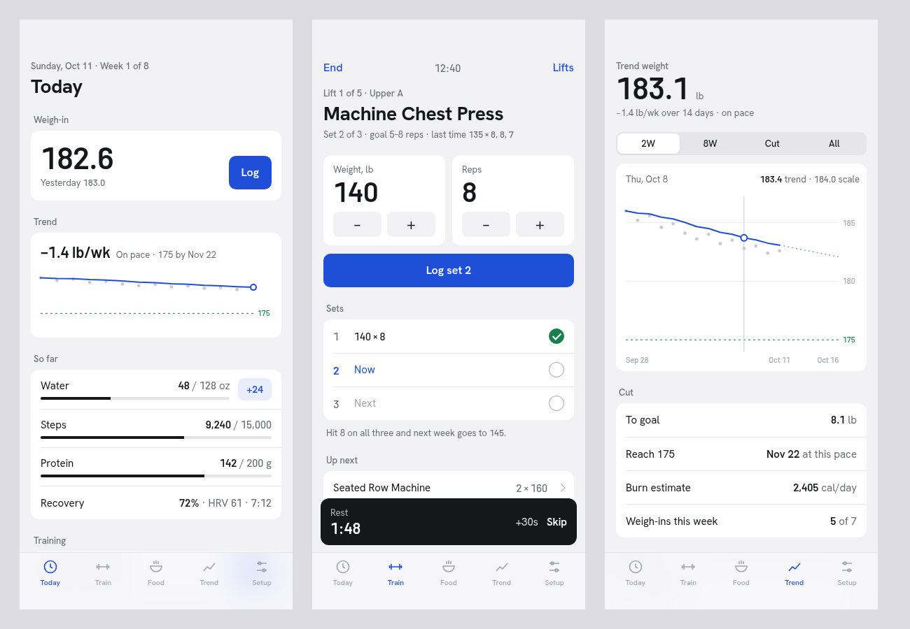
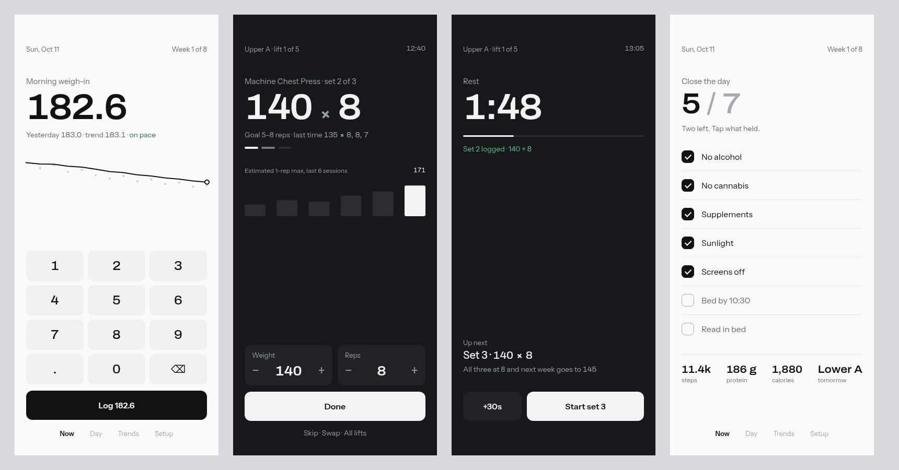

# Health Hub redesign: three directions

**Decided Oct 11: B, Day line, set in Libre Franklin.** Next step: build it into the app. My first pick, C, is kept below for the record.

!!! warning "Two things to know first"
    Mobbin refused the search: its connector needs a paid plan. So I compared against apps I know well instead: Oura, MacroFactor, Strong, Hevy, Apple Health and Things.
    All numbers in these mockups are made up.

## Font for Day line

IBM Plex Mono is gone. It is a code font, and that is what made the numbers look machine-made. Three replacements, each on the same three screens:

**1 · Libre Franklin for words and numbers (chosen).** Built on Franklin Gothic, the type of scoreboards and gym signage. Its numbers are sturdy and easy to read mid-set.

**2 · Schibsted Grotesk for words, Barlow for numbers.** Warmer, newspaper-like words. Barlow is the app's current number font. Its numbers run small in lists.

**3 · Albert Sans for words and numbers.** The quietest of the three. Light and Scandinavian, but the least character.

Live versions: [1](mockups/b-dayline.html?f=1) · [2](mockups/b-dayline.html?f=2) · [3](mockups/b-dayline.html?f=3)

## What is wrong today

- **Everything is a card, and every card shouts.** Borders, shadows, caps labels and orange buttons on almost every block. On the Train tab, three orange buttons compete.
- **Two navigation bars.** Morning, Session, Closeout and Home sit on top, and Home again at the bottom. That is confusing.
- **The disabled button looks broken.** Pale orange reads as an error, not as "type a number first".
- **The type is loud.** Barlow Condensed in capitals on every label is the "magazine" look you banned.
- **The same keypad lives on two tabs** (Home and Scale).

## A · Ledger

Feels like Apple Health. Gray page, white grouped lists, one blue for anything you can tap, green for on track. Words in Hanken Grotesk, numbers in Barlow, which the app already ships.

- **Best at:** calm, familiar, easy to build. Keeps the five tabs.
- **Weakest:** it looks like many other iOS apps. Up against Apple Health it is a tie, not a win.

## B · Day line

The day as a timeline. What you did is one quiet line. What is now is open, with its button. Later things wait below. Food joins Today, so four tabs instead of five. Workout uses the Strong/Hevy set table with a "last time" column. Ember stays, but only for "now".

- **Best at:** answering "what is left today" at a glance. The set table is the fastest logging pattern there is.
- **Weakest:** the mono numbers inside sentences look busy. It is also the biggest rebuild.

## C · One thing (first pick, not chosen)

One screen, one job, one button. A flat keypad at thumb height for the weigh-in. In the gym the screen turns dark and shows only the set, then the rest timer. At night it is a plain checklist. Buttons are black, or white in the dark. Green appears only for "on pace" or "logged". Words in Instrument Sans, numbers in Archivo.

- **Best at:** the most elegant and the fastest with one hand. Up against Oura and Whoop, it holds up.
- **Weakest:** the big numbers come close to the "giant numerals" you banned. I kept them as working numbers, not decoration. Details (food, history) move one tap away to "Day" and "Trends", which I have not drawn yet.

!!! note "Dark mode"
    C needs dark mode for the gym. The project removed dark mode on purpose, so picking C means bringing it back.

## Compared with the best apps

| Pattern | Best in class | A | B | C |
|---|---|---|---|---|
| Weight trend | MacroFactor | Yes | Yes | Small |
| Set logging | Strong, Hevy | Good | Best | Good |
| One clear action | Oura, Whoop | Weak | Good | Best |
| Calm look | Things | Good | Good | Best |

## Try them on your phone

- [A · Ledger](mockups/a-ledger.html)
- [B · Day line](mockups/b-dayline.html)
- [C · One thing](mockups/c-focus.html)
