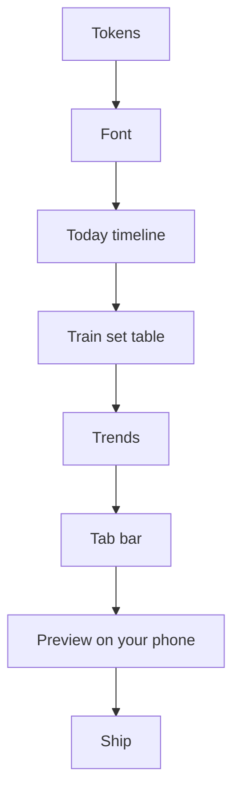

# Day line: build plan

Six steps, built on one new branch and checked on the Pi first. ==All six are built (Oct 11). Nothing goes live until you have tried the preview and said yes.==

!!! warning "Why one push, not six"
    Every push to a `claude/` branch is a production deploy. A half-restyled app would mix two looks for days. So I build all six steps locally, you test a preview over Tailscale, then it ships in one go.

## The steps

1. **Tokens.** Swap the color values in `index.html`: cool gray page `#F5F6F7`, white cards, gray lines. Ember stays for "now" and the main button only. Green means on track. The app's color names stay the same, so every screen picks up the new look at once.
2. **Font.** Self-host Libre Franklin (400, 500, 600) and delete Barlow. Remove the all-caps labels and wide letter spacing across all screens (about 30 places). Tabular figures on numbers only.
3. **Today timeline.** Rebuild Home as the Day line. The Morning, Session, Closeout and Home switcher goes away. Done items shrink to one line, "Now" opens with its button, later items wait below. Food and water join the line.
4. **Train set table.** Replace the one-lift-at-a-time card with the Strong-style table: Set, Last, lb, Reps, check. The current set gets ember-outlined fields. Skip, swap, plates, history and the rest timer all stay.
5. **Trends.** One tab for weight trend, scale history, body comp and lift progress (today's Scale tab plus Progress).
6. **Tab bar.** Four tabs: Today, Train, Trends, You. Thin top line on the active tab, no icons in ember.

## Calls I made on the open questions

- **The weigh-in keypad stays.** It lives inside the morning "Now" block. It is fast with one thumb, and the mockup just did not show it.
- **Food folds into Today.** Cronometer is the source. Quick-log and water live on the Food line. Meal detail opens in a sheet.
- **Trends holds** weight, scale history, body comp and lift progress.
- **Train holds** the training calendar, cardio and the stretch player.
- **You holds** settings, sync health, Coach changes and the old full dashboard.
- **Wednesday fast card** becomes the "Now" item on fast days.
- **Auto-regulation** shows inside the workout "Now" block when recovery is low.

## What stays exactly the same

All the rules and numbers. The engine, sync, Coach, Oura and Cronometer are not touched. This is a new face on the same brain.

## Where it stands

All six steps are built on branch `claude/dayline` and pass the checks. Not pushed yet.

!!! warning "The preview uses your real data"
    The Pi preview talks to the same database as the live app. Anything you log there, like a weigh-in or water, is saved for real.

Changes made along the way:

- **Trends opens on 2W.** On 8W the line and the big number can disagree when weigh-ins are sparse. 2W uses the same math as Today, so they always match.
- **Pace turns green only inside the plan.** Losing faster than 2 lb a week is no longer shown as "on track".
- **The old full dashboard** sits under You and got the same color cleanup.
- **Train home rebuilt** (your ask). A week strip on top, the day's lifts as plain rows, stretch and cardio as two rows under "Also today", then progress and history.
- **New stretch player** (your ask). One pose at a time. Once started it runs itself, with a 5 second "get ready" between sides. Skip side, skip pose, previous, pause and +15 s are always there.
